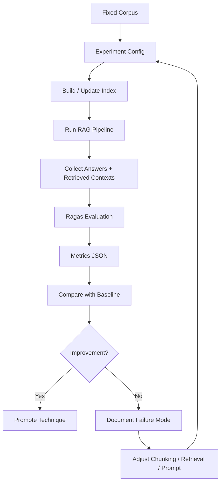
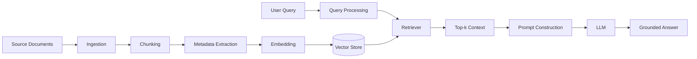
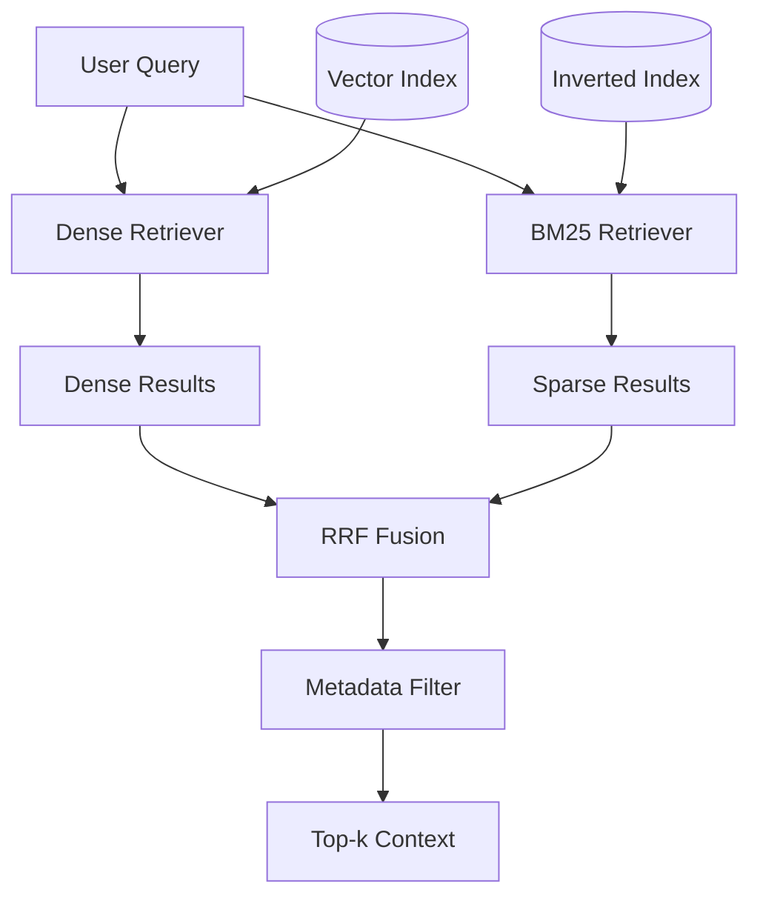
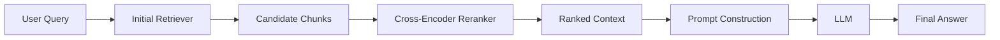
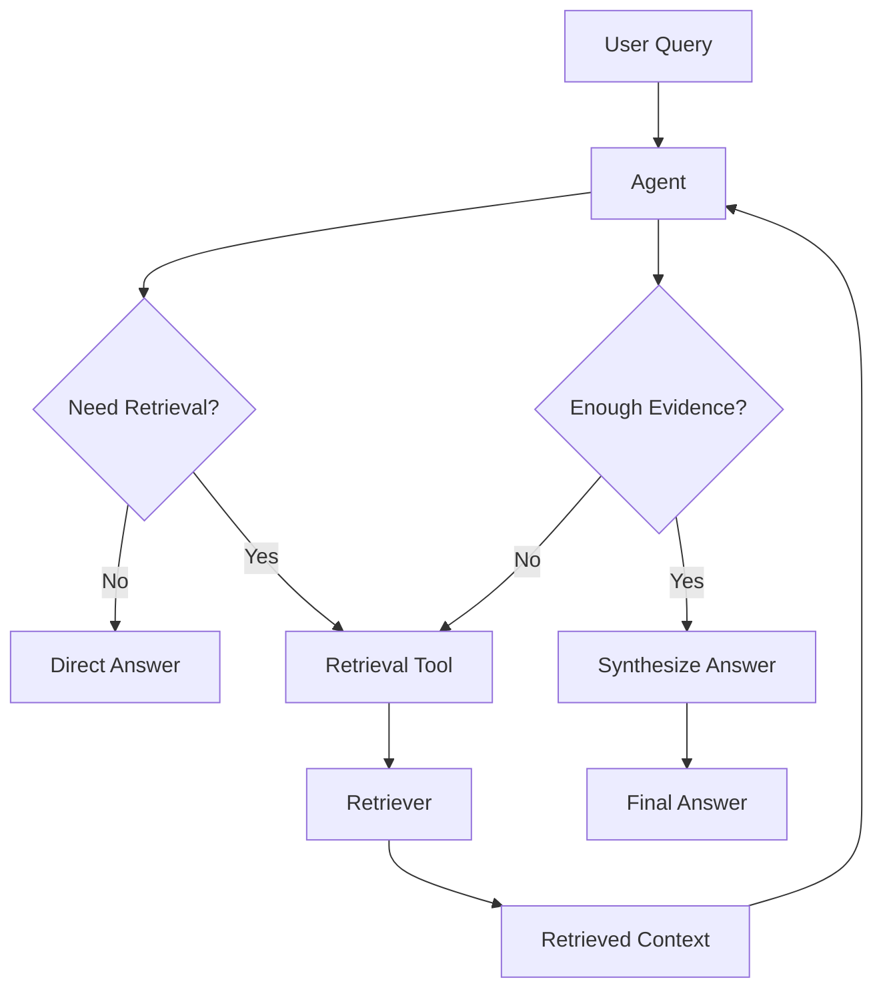
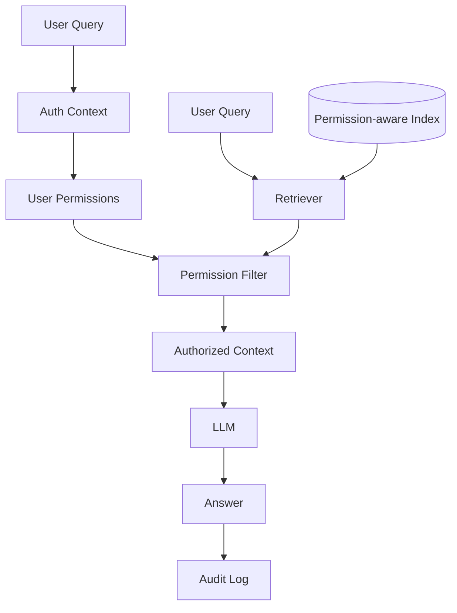

# RAG Learning Project — Plane Management Plan

## 1. Project goal

Build one GitHub monorepo named `learning-rag` for two developers who know backend work but not RAG. They will go from basic RAG through advanced RAG, Agentic RAG, GraphRAG, and permission-aware RAG.

The project is learn-by-building: implement, ask a model when stuck, and use evaluation to check whether a change helped. It is not a line-by-line textbook reading project.

Every RAG technique is a rerunnable, comparable, recorded experiment. Every experiment uses the same corpus and test set, so a change can be judged on retrieval or generation quality.

### Definition of success

After this project, both members should be able to:

- Design and implement RAG from naive to advanced on their own.
- Use hybrid search, reranking, query transformation, and contextual chunking.
- Build repeatable RAG evaluation with Ragas / LangSmith.
- Analyze retrieval failures and generation failures.
- Compare RAG architectures on quality, latency, and cost.
- Design permission-aware RAG and multi-source RAG.
- Write technical notes and mermaid diagrams that the team can read.

## 2. Learning principles

- About 4 hours per person per day, 5 days a week.
- Implementation first. Read official docs or articles only to unblock the current task.
- Every technique gets a baseline comparison.
- Finishing a notebook is not the definition of done.
- Every experiment has a hypothesis, a method, a fixed dataset, metrics, results, and a conclusion.
- Teaching notes, mermaid diagrams, and experiment results live in the GitHub repo and in Plane Pages.
- Plane tracks tasks, milestones, discussion, and progress. GitHub tracks code, notebooks, experiment results, and versions.

## 3. Schedule

At 4 hours per person per day, 5 days a week, the full track is about **8–10 weeks, 160–200 hours per person**.

| Phase | Topic | Estimate | Main output |
|---|---|---:|---|
| Phase 0 | Environment, repo, corpus, evaluation harness | 2–3 days | Rerunnable skeleton, fixed corpus, test set |
| Phase 1 | Naive RAG baseline | 3–4 days | Basic RAG and a Ragas baseline |
| Phase 2 | Ingestion, chunking, metadata, contextual retrieval | 4–5 days | Comparison of at least two ingestion strategies |
| Phase 3 | Dense / sparse / hybrid retrieval, RRF, metadata filter | 3–4 days | A hybrid retrieval version |
| Phase 4 | Query transformation, HyDE, multi-query, reranking | 4–5 days | At least two query or rerank strategies |
| Phase 5 | Deeper evaluation, failure analysis, regression | 3–4 days | A full evaluation workflow |
| Phase 6 | Advanced RAG: Adaptive, Self / Corrective, GraphRAG | 5–7 days | 1–2 advanced architecture prototypes |
| Phase 7 | Agentic RAG, routing, tool-based retrieval | 4–6 days | An agentic RAG prototype |
| Phase 8 | Permission-aware RAG, production concerns | 4–6 days | Permission filter, audit, security design notes |

Hybrid search, reranking, contextual retrieval, and a full evaluation loop are enough for a solid base in about 4–5 weeks. Covering GraphRAG, Agentic RAG, and permission-aware RAG needs the full 8–10 weeks.

## 4. Core learning resources

### 4.1 Basic RAG

#### LlamaIndex — Introduction to RAG

- URL: [https://developers.llamaindex.ai/python/framework/understanding/rag/](https://developers.llamaindex.ai/python/framework/understanding/rag/)
- Use: first primary text.
- Covers: Loading, Indexing, Storing, Querying, Evaluation; Retriever, Query Engine, Router.
- Focus: a mental model of the full RAG data flow.
- How to use: read the concept, then implement it on your own corpus immediately.

#### LangChain — rag-from-scratch

- URL: [https://github.com/langchain-ai/rag-from-scratch](https://github.com/langchain-ai/rag-from-scratch)
- Use: baseline implementation text.
- Covers: indexing, retrieval, generation, multi-query, RAG-Fusion, decomposition, step-back, HyDE, routing, CRAG, Self-RAG, Adaptive RAG.
- Focus: build RAG from pieces and see how they connect.
- How to use: fork or copy the notebook shape, but rewrite the code against your own corpus.

#### LangChain — Retrieval / 2-Step RAG

- URL: [https://docs.langchain.com/oss/python/deepagents/retrieval](https://docs.langchain.com/oss/python/deepagents/retrieval)
- Use: retrieval as a service, not a prompt trick.
- Covers: document loaders, embeddings, vector stores, 2-Step RAG, Agentic RAG.
- Focus: RAG is a backend retrieval pipeline.

### 4.2 Ingestion and chunking

#### Anthropic — Contextual Retrieval

- URL: [https://platform.claude.com/cookbook/capabilities-contextual-embeddings-guide](https://platform.claude.com/cookbook/capabilities-contextual-embeddings-guide)
- Use: core text for chunking and contextual retrieval.
- Covers: Contextual Embeddings, Contextual BM25, reranking.
- Focus: a chunk is not a character count. It must still make sense at retrieval time.
- How to use: compare naive chunking with contextual chunking at least once.

#### Microsoft — RAG Use Cases for Developers

- URL: [https://www.microsoft.com/en-us/software-development-companies/resources/articles/rag-use-cases-for-developers](https://www.microsoft.com/en-us/software-development-companies/resources/articles/rag-use-cases-for-developers)
- Use: an enterprise RAG view.
- Covers: Ingestion, Retrieval, Augmentation, Generation, semantic search, enterprise data integration.
- Focus: where sources, permissions, security, and scale sit in RAG.

### 4.3 Retrieval, hybrid search, and reranking

#### Atlan — 12 Advanced RAG Techniques Beyond Naive Retrieval

- URL: [https://atlan.com/know/advanced-rag-techniques/](https://atlan.com/know/advanced-rag-techniques/)
- Use: map of advanced techniques.
- Covers: query transformation, HyDE, hybrid search, contextual chunking, reranking, GraphRAG, RAPTOR, Self-RAG, Adaptive RAG.
- Focus: diagnose the failure mode before adding complexity.
- How to use: pick a technique for the current experiment. Do not stack them by default.

#### NirDiamant — RAG_TECHNIQUES

- URL: [https://github.com/NirDiamant/RAG_TECHNIQUES](https://github.com/NirDiamant/RAG_TECHNIQUES)
- Use: implementation exercises.
- Covers: hybrid retrieval, reranking, LLM scoring, cross-encoder, metadata-enhanced ranking, Graph RAG, agentic RAG.
- Focus: code for retrieval and reranking techniques.
- How to use: pick notebooks for the current phase and rewrite them as your experiment.

#### Advanced RAG — Hybrid Search, Reranking & Knowledge Graphs

- URL: [https://myengineeringpath.dev/genai-engineer/advanced-rag/](https://myengineeringpath.dev/genai-engineer/advanced-rag/)
- Use: extra reading on hybrid search and reranking.
- Covers: BM25 + dense retrieval, RRF, cross-encoder reranking, query transformation, knowledge graphs.
- Focus: hybrid search raises recall; reranking raises precision.

#### Vucense — Advanced RAG: HyDE, Reranking & Hybrid Search

- URL: [https://vucense.com/dev-corner/advanced-rag-hyde-reranking-hybrid-search-2026/](https://vucense.com/dev-corner/advanced-rag-hyde-reranking-hybrid-search-2026/)
- Use: implementation reference for HyDE, reranking, and hybrid search.
- Covers: HyDE, cross-encoder reranking, BM25 hybrid search.
- Focus: how query transformation, retrieval, and reranking connect.

#### Building Scalable RAG Pipelines with Hybrid Search and Re-ranking

- URL: [https://martinuke0.github.io/posts/2026-03-22-building-scalable-rag-pipelines-with-hybrid-search-and-advanced-re-ranking-techniques/](https://martinuke0.github.io/posts/2026-03-22-building-scalable-rag-pipelines-with-hybrid-search-and-advanced-re-ranking-techniques/)
- Use: RRF and reranking trade-offs.
- Covers: linear fusion, RRF, cross-encoder, LLM reranker.
- Focus: latency, cost, and quality.

### 4.4 Advanced architectures

#### LangChain — Build a custom RAG agent with LangGraph

- URL: [https://docs.langchain.com/oss/python/langgraph/agentic-rag](https://docs.langchain.com/oss/python/langgraph/agentic-rag)
- Use: Agentic RAG implementation text.
- Covers: retriever tool, agent decisions, LangSmith tracing.
- Focus: when the agent retrieves, how it calls tools, and how it handles multi-step tasks.

#### LangChain — RAG with Deep Agents

- URL: [https://docs.langchain.com/oss/python/deepagents/rag](https://docs.langchain.com/oss/python/deepagents/rag)
- Use: large knowledge bases and multi-agent layout.
- Covers: index, search tool, subagent analysis, synthesize.
- Focus: keep the main agent context small and hand retrieved text to a subagent.

#### RAG Techniques Compared

- URL: [https://blog.starmorph.com/blog/rag-techniques-compared-best-practices-guide](https://blog.starmorph.com/blog/rag-techniques-compared-best-practices-guide)
- Use: technique selection.
- Covers: naive RAG, advanced RAG, agentic RAG, GraphRAG: shape, cost, and fit.
- Focus: when not to use GraphRAG, and when an agent loop is worth it.

#### LlamaIndex — Building RAG from Scratch

- URL: [https://developers.llamaindex.ai/python/framework/optimizing/building_rag_from_scratch/](https://developers.llamaindex.ai/python/framework/optimizing/building_rag_from_scratch/)
- Use: lower-level retriever design.
- Covers: query rewriting, ensembling, dynamic retrieval.
- Focus: do not stop at the framework query engine. A retriever can be custom.

### 4.5 Evaluation

#### Ragas — Available Metrics

- URL: [https://docs.ragas.io/en/stable/concepts/metrics/available_metrics/](https://docs.ragas.io/en/stable/concepts/metrics/available_metrics/)
- Use: evaluation standard.
- Covers: Context Precision, Context Recall, Context Entities Recall, Noise Sensitivity, Response Relevancy, Faithfulness.
- Focus: score retrieval and generation separately.

#### Ragas — Faithfulness

- URL: [https://docs.ragas.io/en/stable/concepts/metrics/available_metrics/faithfulness/](https://docs.ragas.io/en/stable/concepts/metrics/available_metrics/faithfulness/)
- Use: measure hallucination and unsupported claims.
- Covers: whether claims in the answer are supported by retrieved context.
- Focus: a plausible answer is not enough. Context must support it.

#### Ragas — Context Precision

- URL: [https://docs.ragas.io/en/stable/concepts/metrics/available_metrics/context_precision/](https://docs.ragas.io/en/stable/concepts/metrics/available_metrics/context_precision/)
- Use: check ranking quality.
- Covers: whether relevant chunks are ranked first.
- Focus: reranking, metadata filters, and query rewrite should show up here.

#### Ragas — Evaluating Using Your Test Set

- URL: [https://docs.ragas.io/en/v0.1.21/getstarted/evaluation.html](https://docs.ragas.io/en/v0.1.21/getstarted/evaluation.html)
- Use: evaluation workflow.
- Covers: separate retriever metrics and generator metrics.
- Focus: Context Precision / Recall score the retriever. Faithfulness / Answer Relevancy score the generator.

#### LangSmith — Evaluate a RAG application

- URL: [https://docs.langchain.com/langsmith/evaluate-rag-tutorial](https://docs.langchain.com/langsmith/evaluate-rag-tutorial)
- Use: a repeatable evaluation dataset and run.
- Covers: question / expected answer test set, run RAG, produce evaluation results.
- Focus: every change runs the same test set.

### 4.6 AI application and system design

#### ombharatiya — AI System Design Guide

- URL: [https://github.com/ombharatiya/ai-system-design-guide](https://github.com/ombharatiya/ai-system-design-guide)
- Use: from RAG engineer to AI application engineer.
- Covers: model selection, RAG pipelines, agent orchestration, memory, observability, safety, offline evals, online metrics, tracing.
- Focus: design includes retrieval, agents, evaluation, observability, safety, and cost.

#### Nexaitech — AI Application Design Patterns

- URL: [https://nexaitech.com/ai-application-design-patterns/](https://nexaitech.com/ai-application-design-patterns/)
- Use: LLM application patterns.
- Covers: RAG, routing, tool use, agents, memory, approvals, evaluation, fallbacks.
- Focus: when RAG is wrong, degrade, rewrite the query, tell the user, or hand off.

## 5. GitHub repo layout

Use one repo:

```text
learning-rag/
```

### 5.1 Directory layout

```text
learning-rag/
├─ README.md
├─ pyproject.toml
├─ uv.lock
├─ .env.example
├─ .gitignore
├─ Makefile
├─ docs/
│  ├─ 00-learning-roadmap.md
│  ├─ 01-core-concepts.md
│  ├─ 02-evaluation-guide.md
│  ├─ 03-experiment-template.md
│  ├─ 04-architecture-decisions.md
│  └─ diagrams/
│     ├─ naive-rag.mmd
│     ├─ contextual-rag.mmd
│     ├─ hybrid-rag.mmd
│     ├─ reranking-rag.mmd
│     ├─ graph-rag.mmd
│     ├─ agentic-rag.mmd
│     └─ permission-aware-rag.mmd
├─ data/
│  ├─ raw/
│  ├─ processed/
│  └─ corpora/
│     └─ demo_docs/
├─ datasets/
│  ├─ eval_questions.csv
│  ├─ eval_expected_contexts.csv
│  ├─ no_answer_questions.csv
│  └─ regression_cases.csv
├─ src/
│  └─ learning_rag/
│     ├─ __init__.py
│     ├─ chunks/
│     ├─ ranks/
│     ├─ llm.py
│     └─ shared/
│        └─ settings.py
├─ experiments/
│  ├─ e01_naive_rag/
│  │  ├─ README.md
│  │  └─ run.py
│  ├─ 02_contextual_chunking/
│  ├─ 03_hybrid_search/
│  ├─ 04_reranking/
│  ├─ 05_hyde/
│  ├─ 06_graph_rag/
│  ├─ 07_agentic_rag/
│  └─ 08_permission_aware_rag/
├─ scripts/
│  ├─ ingest.py
│  ├─ build_index.py
│  ├─ evaluate.py
│  ├─ compare_results.py
│  └─ generate_report.py
└─ tests/
   └─ test_ingest_to_eval.py
```

A unit test sits beside the module it tests, named `test_<module>.py`. The runner is pytest. `tests/` holds integration tests and other tests that cross package boundaries.

### 5.2 Initial dependencies

Create one package with `uv`. Do not use uv workspaces yet.

```bash
uv init learning-rag
cd learning-rag

uv add langchain langchain-community langchain-openai \
  langgraph llama-index ragas chromadb rank-bm25 \
  pydantic-settings python-dotenv

uv add --dev pytest ruff mypy jupyterlab
```

Move to uv workspaces only if experiments need different dependency sets, or if `core`, `evaluation`, and `experiments` should become separate packages.

## 6. Experiment rules

Each technique lives under `experiments/` and uses the same shape. The directory number matches one learning-sequence item. RAG-9 is `e01_naive_rag`. `src/learning_rag` holds reusable functions in capability packages such as `chunks/` and `ranks/`. The experiment directory holds `run.py`, which calls ingestion, retrieval, prompt, and generation in that order. A unit test of a shared function sits beside that function.

### 6.1 Experiment directory

```text
experiments/03_hybrid_search/
├─ README.md
├─ config.yaml
├─ run.py
├─ notebook.ipynb
└─ results/
   ├─ metrics.json
   ├─ retrieval_samples.json
   └─ comparison.md
```

### 6.2 Experiment README template

```markdown
# Experiment: Hybrid Search + RRF

## Hypothesis
BM25 + dense retrieval improves recall for exact technical terms, API names, and identifiers.

## Baseline
Naive dense RAG

## Variables
- Dense retriever: text-embedding-3-small
- Sparse retriever: BM25
- Fusion method: RRF
- RRF k: 60
- Top-k before rerank: 20
- Final top-k: 5

## Dataset
- 50 answerable questions
- 10 no-answer questions
- 10 exact-term questions

## Metrics
- Context Recall
- Context Precision
- Faithfulness
- Answer Relevancy
- p50 latency
- p95 latency
- Token cost

## Results

| Version | Context Recall | Context Precision | Faithfulness | Answer Relevancy | p95 Latency | Token Cost |
|---|---:|---:|---:|---:|---:|---:|
| Naive RAG |  |  |  |  |  |  |
| Hybrid + RRF |  |  |  |  |  |  |

## Retrieval Failure Examples
- Question:
- Expected context:
- Retrieved context:
- Failure reason:

## Conclusion
```

## 7. Evaluation rules

Evaluation is a first-class part of this project. Without it, do not claim a technique improved anything.

### 7.1 Required metrics

| Category | Metric | Question it answers |
|---|---|---|
| Retrieval | Context Recall | Was the needed information retrieved? |
| Retrieval | Context Precision | Are relevant chunks ranked first? |
| Generation | Faithfulness | Is the answer supported by retrieved context? |
| Generation | Answer Relevancy | Does the answer address the question? |
| Robustness | No-answer accuracy | Does the system avoid guessing when there is no answer? |
| System | p50 / p95 latency | How long does the user wait? |
| System | Token cost / API cost | Is the cost per query acceptable? |

### 7.2 Test set requirements

- At least 50 answerable questions.
- At least 10 no-answer questions.
- At least 10 exact-term questions, to test BM25 / hybrid search.
- At least 10 multi-document questions, to test cross-document answers.
- Each item has: question, expected answer, expected source / context, question type, difficulty.
- Do not edit the test set mid-experiment. If it must change, cut a new version and rerun every baseline.

### 7.3 Evaluation flow



## 8. Learning phases and Plane issues

### Phase 0: Project setup

**Goal**: a rerunnable environment and an evaluation base.

**Issues**

1. Create the `learning-rag` GitHub repo.
2. Initialize the Python project with `uv init`.
3. Create the `src/learning_rag` package.
4. Create `docs/`, `data/`, `datasets/`, `experiments/`, `scripts/`, `tests/`.
5. Choose and prepare a fixed demo corpus.
6. Design a metadata schema, for example source, title, section, doc_id, permissions.
7. Build evaluation test set v1.
8. Build a Ragas evaluation script.
9. Record latency and token cost.
10. Add an experiment README template.
11. Add a Makefile with `make ingest`, `make index`, and `make evaluate`.
12. Add `.env.example` for required API keys and settings.

**Definition of Done**

- After clone, either member can run the baseline from the README within 15 minutes.
- `make evaluate` writes a metrics JSON file.
- The test set has at least 50 answerable questions and 10 no-answer questions.

### Phase 1: Naive RAG baseline

**Goal**: the simplest RAG that can still be measured.

**Issues**

1. Implement a document loader.
2. Implement a basic chunker.
3. Implement an embedding client.
4. Build a vector store index.
5. Implement a dense retriever.
6. Implement a prompt template.
7. Implement LLM answer generation.
8. Add citation / source reference.
9. Run Ragas evaluation.
10. Write the naive RAG baseline report.
11. Draw the naive RAG mermaid diagram.
12. Record at least 10 retrieval failure examples.

**Definition of Done**

- The system answers questions from the fixed corpus.
- Every answer has a source.
- Ragas baseline metrics exist.
- Latency and token cost are recorded.
- At least 10 failure cases are analyzed.

### Phase 2: Ingestion and contextual chunking

**Goal**: improve splits so a chunk is still understandable.

**Issues**

1. Compare fixed-size, recursive, and semantic chunking.
2. Design chunk metadata.
3. Add document title, section, and heading context.
4. Implement Anthropic-style contextual retrieval.
5. Compare naive chunking with contextual chunking.
6. Measure how chunk size changes Context Recall / Precision.
7. Add ingestion pipeline tests.
8. Draw the ingestion and contextual retrieval mermaid diagram.

**Definition of Done**

- At least two chunking strategies are compared.
- Each strategy has Ragas results.
- You can say which document type fits which chunking method.
- The conclusion states whether it improved, and why.

### Phase 3: Hybrid retrieval

**Goal**: combine dense and sparse retrieval for exact terms, identifiers, and keywords.

**Issues**

1. Implement a BM25 retriever.
2. Implement a dense vector retriever.
3. Implement RRF fusion.
4. Implement a metadata filter.
5. Compare dense-only, BM25-only, and hybrid.
6. Test exact-term questions.
7. Test no-answer questions.
8. Record the latency increase.
9. Draw the hybrid retrieval mermaid diagram.

**Definition of Done**

- Results exist for dense-only, BM25-only, and hybrid.
- You can say whether hybrid improves exact-term retrieval.
- You can say how the RRF parameter changes results.
- Precision / recall / latency trade-off is explicit.

### Phase 4: Query transformation and reranking

**Goal**: improve vague questions, indirect questions, and ranking.

**Issues**

1. Implement query rewriting.
2. Implement multi-query retrieval.
3. Implement HyDE.
4. Implement a cross-encoder reranker.
5. Compare no-rerank, cross-encoder rerank, and LLM rerank.
6. Compare retrieval before and after query rewrite.
7. Record reranking latency and cost.
8. Draw the query transformation and reranking mermaid diagram.

**Definition of Done**

- At least two of HyDE, multi-query, and reranking are done.
- Each technique has a baseline comparison.
- You can name which question types benefit most.
- You can say whether the extra latency is worth it.

### Phase 5: Deeper evaluation

**Goal**: a regression evaluation system that lasts.

**Issues**

1. Version the evaluation dataset.
2. Add no-answer evaluation.
3. Add an exact-term evaluation subset.
4. Add a multi-document evaluation subset.
5. Add a retrieval failure analysis template.
6. Add a generation failure analysis template.
7. Add an experiment comparison report generator.
8. Add a regression checklist.
9. Collect historical experiment results into a comparison dashboard or Markdown report.

**Definition of Done**

- Any new RAG version can be compared with the baseline in one command.
- Metrics comparison can be produced automatically.
- Retrieval failure and generation failure are distinguished.
- At least 3 finished experiments are in the historical comparison.

### Phase 6: Advanced RAG

**Goal**: pick an advanced architecture from the failure mode, not from novelty.

**Issues**

1. Study Adaptive RAG.
2. Study Self-RAG / Corrective RAG.
3. Study RAPTOR.
4. Study GraphRAG.
5. Decide whether the current corpus needs GraphRAG.
6. If it does, implement a small GraphRAG prototype.
7. Compare vector RAG with GraphRAG.
8. Record GraphRAG index build cost and query latency.
9. Draw the GraphRAG mermaid diagram.

**Definition of Done**

- You can say when GraphRAG fits and when it does not.
- At least one advanced RAG prototype exists.
- A baseline comparison exists.
- If GraphRAG did not help, the reason is written down.

### Phase 7: Agentic RAG

**Goal**: the system decides whether to retrieve, how to retrieve, and whether to retrieve again.

**Issues**

1. Wrap the retriever as a tool.
2. Build an agent workflow with LangGraph.
3. Implement a retrieve / no-retrieve decision.
4. Implement multi-hop retrieval.
5. Add query planning.
6. Add answer synthesis.
7. Add LangSmith tracing.
8. Compare single-shot RAG with agentic RAG.
9. Record token cost, latency, and success rate.
10. Draw the agentic RAG mermaid diagram.

**Definition of Done**

- The agent can decide whether to call the retrieval tool.
- A trace is inspectable.
- A baseline comparison exists.
- You can say when agentic RAG is worth the cost.

### Phase 8: Permission-aware RAG and production concerns

**Goal**: permissions, safety, and operability for enterprise RAG.

**Issues**

1. Design a document-level permission model.
2. Design a user / group / role model.
3. Write permission metadata at ingestion time.
4. Apply a permission filter at retrieval time.
5. Test that unauthorized documents cannot be retrieved.
6. Test that different users get different results for the same question.
7. Design an audit log.
8. Design fallback and no-answer policy.
9. Design a caching strategy.
10. Write the permission-aware RAG architecture note.
11. Draw the permission-aware RAG mermaid diagram.

**Definition of Done**

- Unauthorized documents do not appear in retrieved context.
- Permission test cases exist.
- An audit log design exists.
- An architecture note and a mermaid diagram exist.

## 9. Suggested Plane structure

Create a Plane project:

```text
RAG Learning Project
```

### 9.1 Modules

1. `Phase 0 — Project Setup`
2. `Phase 1 — Naive RAG`
3. `Phase 2 — Ingestion & Contextual Chunking`
4. `Phase 3 — Hybrid Retrieval`
5. `Phase 4 — Query Transformation & Reranking`
6. `Phase 5 — Evaluation & Regression`
7. `Phase 6 — Advanced RAG`
8. `Phase 7 — Agentic RAG`
9. `Phase 8 — Permission-aware RAG & Production`

### 9.2 Issue labels

- `setup`
- `learning`
- `implementation`
- `evaluation`
- `documentation`
- `diagram`
- `experiment`
- `research`
- `bug`
- `improvement`

### 9.3 Issue template

Each implementation issue should include:

```markdown
## Goal
What will be finished?

## Learning Resources
- [Resource name](URL)

## Implementation Plan
1.
2.
3.

## Evaluation
- Baseline:
- Metrics:
- Expected improvement:

## Deliverables
- [ ] Code
- [ ] Test set results
- [ ] README
- [ ] Mermaid diagram
- [ ] Plane update

## Definition of Done
```

### 9.4 Suggested Pages

1. `RAG Learning Roadmap`
2. `Core RAG Concepts`
3. `Evaluation Guide`
4. `Experiment Template`
5. `Resource Library`
6. `Architecture Decision Records`
7. `Weekly Learning Notes`
8. `Failure Mode Catalog`
9. `Mermaid Diagram Library`

## 10. Mermaid rules

- One diagram, one concept.
- Nodes are clear nouns.
- Edges are explicit verbs or relations.
- Do not put every RAG variant in one diagram.
- Each diagram should answer one question on its own.
- Split advanced topics into a concept diagram and an implementation diagram.
- Do not put extra SDK, API, or model names in a diagram unless the diagram is about implementation.

### 10.1 Naive RAG



### 10.2 Hybrid Retrieval



### 10.3 Reranking



### 10.4 Agentic RAG



### 10.5 Permission-aware RAG



## 11. Two-person split

Both people learn the whole track. Each area has a primary owner, and both still review the work.

| Area | Primary owner | Shared work |
|---|---|---|
| Repo, uv, CI, coding style | Member A | Code review |
| Corpus, chunking, metadata | Member A | Test case design |
| Retrieval, hybrid, reranking | Member B | Retrieval failure analysis |
| Evaluation harness, Ragas, report | Member A | Reading the results |
| Prompt, generation, citation | Member B | Hallucination check |
| Plane pages, learning notes, mermaid diagrams | Rotate | Weekly sync |

## 12. Weekly rhythm

| When | Work |
|---|---|
| Monday | Plan the week's experiment and confirm the evaluation dataset |
| Tuesday to Thursday | Implement, run experiments, analyze failures |
| Friday | Finish the report, update Plane, tidy mermaid diagrams, review what was learned |

## 13. Instructions for a Plane agent

Follow this document and create a Plane project named **RAG Learning Project**.

Create these modules:

1. Phase 0 — Project Setup
2. Phase 1 — Naive RAG
3. Phase 2 — Ingestion & Contextual Chunking
4. Phase 3 — Hybrid Retrieval
5. Phase 4 — Query Transformation & Reranking
6. Phase 5 — Evaluation & Regression
7. Phase 6 — Advanced RAG
8. Phase 7 — Agentic RAG
9. Phase 8 — Permission-aware RAG & Production

Create the issues listed above for each phase. Each issue includes:

- Goal
- Learning Resources
- Implementation Plan
- Evaluation
- Deliverables
- Definition of Done

Also create these Pages:

1. RAG Learning Roadmap
2. Core RAG Concepts
3. Evaluation Guide
4. Experiment Template
5. Resource Library
6. Architecture Decision Records
7. Weekly Learning Notes
8. Failure Mode Catalog
9. Mermaid Diagram Library

Put every resource URL from this document into `Resource Library`, grouped as:

- Basic RAG
- Ingestion & Chunking
- Retrieval & Hybrid Search
- Query Transformation & Reranking
- Advanced RAG
- Agentic RAG
- Evaluation
- AI System Design

Put every mermaid diagram from this document into `Mermaid Diagram Library`, one page per topic.

Set all Phase 0 issues as the first batch of work, and Phase 1 issues as the next batch. Create the other phases as backlog, and refine them after Phase 0 and Phase 1 are done.
