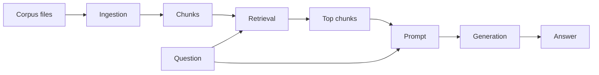

# Experiment: naive RAG baseline

RAG-9 的 baseline。100 篇固定版本的 PEP，每 500 字元切塊、重疊 80 字元，以詞頻 cosine 排名。保留前 5 個 chunk，其中前 3 個送給模型。CLI 與評估共用 `run_query()`。



## 這次要確認什麼

問題沿用文件原詞時，詞頻 cosine 應該能找到相關文件；改用同義詞或一次問兩份文件時，預期會漏。這版先把結果固定下來，後續方法都用同一份 corpus 和題庫比較。

## 固定資料與設定

- Corpus：`data/raw/peps/` 的 100 篇 PEP，來源 commit `d999c848d809b682ef80151915f2040932704b1f`。
- 題庫：`datasets/eval_questions.csv`，14 題原詞、8 題同義詞、6 題 multi-hop、2 題無答案。本次沒有改題目或標註。
- 切塊和檢索參數：`config.yaml`。模型名稱、endpoint 和 token 上限：`.env`。
- 本次生成：OpenAI `gpt-6.1-sol`、`reasoning_effort=low`、`max_completion_tokens=1200`。
- `metrics.json` 記錄實際模型設定、corpus、題庫及實作的 SHA-256。每題另存實際 request、回傳模型名稱、response ID、usage 與 finish reason，不記錄 key。

## 重跑

從 repo 根目錄執行：

```bash
uv sync --group dev
uv run pytest -q
uv run python -m experiments.e01_naive_rag.run
uv run python -m experiments.e01_naive_rag.run "What does PEP stand for?"
uv run python -m experiments.e01_naive_rag.eval
uv run python -m experiments.e01_naive_rag.run --answer "What does PEP stand for?"
uv run python -m experiments.e01_naive_rag.eval --answer
```

不加 `--answer` 的執行不用 API key。`eval` 預設只跑檢索，輸出到 `results/retrieval/`；加上 `--answer` 才呼叫模型，輸出到 `results/`。可用 `--output <directory>` 另外存一輪結果。生成發生錯誤或被截斷時，評估仍保存逐題紀錄，結束碼為 1。

OpenAI 的 `.env` 範例：

```dotenv
MODEL_API_KEY=填入自己的key
MODEL_BASE_URL=https://api.openai.com/v1
MODEL_NAME=gpt-6.1-sol
MODEL_MAX_TOKENS=1200
MODEL_REASONING_TOKENS=400
```

`MODEL_REASONING_TOKENS` 只用於 OpenRouter；OpenAI 這次用 `reasoning_effort`。`--free` 僅接受 OpenRouter 的 `:free` 模型，不能用來執行 OpenAI 呼叫。`.env` 不進 Git。

## 指標怎麼算

- **Recall@5**：前 5 個 chunk 覆蓋的相關文件數 ÷ 該題相關文件總數。兩份找到一份是 0.5，同一文件的多個 chunk 不重複加分。
- **MRR@5**：第一個相關 chunk 排名的倒數，再對題目取平均；前 5 沒找到就是 0。
- **all_docs_at_5**：該題需要的文件是否全部出現。這是舊版名為 Recall 的算法，現在保留獨立欄位。
- **context_recall**：送入 prompt 的前 3 個 chunk 覆蓋多少相關文件。

以上的 K 都指 chunk 數，不會先把相同文件去重再補滿 K。兩題無答案題不列入 Recall 或 MRR 分母，另看是否精確回覆 `I do not know.`。這個拒答檢查不評估其他回答的正確率。

延遲從每題檢索開始，包含排名、組 prompt 和模型回覆；讀 corpus 和切塊是一次性的 ingestion，另外列出。`e2e_ms_p50` 包含所有生成嘗試，`successful_e2e_ms_p50` 只含成功回覆。偶數筆的中位數取中間兩筆平均。

## 結果

2026-11-01，Python 3.12.15，使用上述設定。

| 題型 | 題數 | Recall@5 | MRR@5 | 全部文件找齊 | Prompt 文件覆蓋 |
|---|---:|---:|---:|---:|---:|
| 原詞 | 14 | 1.000 | 0.804 | 1.000 | 0.929 |
| 同義詞 | 8 | 0.375 | 0.313 | 0.375 | 0.375 |
| Multi-hop | 6 | 0.333 | 0.375 | 0.167 | 0.250 |
| 有答案題合計 | 28 | 0.679 | 0.571 | 0.643 | 0.625 |

30 次生成全部正常結束，兩題無答案題都拒答。檢索延遲中位數 65.6 ms，端到端中位數 2103.6 ms；一次性讀檔與切塊 17.316 ms。這是本機與當次 API 的量測，沒有做負載測試。

舊版 Recall 是 0.643，這次是 0.679，原因是兩題 multi-hop 各得到 0.5 的部分召回分數。排名沒有因此改善。舊版評估還曾用前 5 個 chunk 生成，CLI 卻只用前 3 個；現在統一為前 3 個。生成模型也換成 Sol，所以兩輪回答和延遲不能當成同條件的改善幅度。

## 10 筆檢索失敗

編號為 CSV 題目順序，不含標題列；文件欄省略 `pep-` 和 `.rst`。完整原文、前 5 名、prompt 與回答都在 `results/failures.json`。本輪這 10 題的生成結果都是拒答。

| 題號／問題 | 應找文件 | 實際觀察 |
|---|---|---|
| 15 commenting functions | 0257 | 前 5 沒有 0257；第一名 0209 的片段在談 CFunc 和 coercion rules，functions、rules 等共同詞讓它排前面。 |
| 17 pauses and resumes | 0255 | 前 5 沒有 generators 的文件，反而有矩陣運算。改寫成日常用語後，詞頻沒有抓到題意。 |
| 18 declare its character set | 0263 | 前 5 沒有 source encodings，第一名在談 function attributes。character set 和 encodings 的用詞落差沒有處理。 |
| 20 adding to its current value | 0203 | 前 5 沒有 augmented assignment；第一名是雜湊函式的 digest size。一般詞不足以辨認 `+=` 的意思。 |
| 22 compressed bundle | 0273 | 前 5 沒有 zip import；compressed bundle 與 zip 的關係沒有表示在詞頻裡，第一名是 0246 的適配器程式碼。 |
| 23 Zen of Python + PEP means | 0020、0001 | 兩份都沒找到，前 3 還重複出現 0277，context 名額被同一份無關文件佔掉。 |
| 24 docstring rules + framework | 0257、0256 | 找到 0216 的 docstring 說明，但兩份標註文件都沒找到。它是相關主題，仍不足以涵蓋這題的規則與框架。 |
| 25 inline loops + walking sequence | 0202、0234 | 0234 在第一名，0202 沒找到。Recall 是 0.5，RR 是 1；RR 高仍可能漏掉另一半問題。 |
| 26 pause/resume + walking items | 0255、0234 | 兩份都沒找到，前 3 是 0209、0207、0212。這題同時有同義詞與多文件需求。 |
| 27 code layout + character set | 0008、0263 | 0008 在第 4，0263 沒找到。Recall 是 0.5，但前 3 的 prompt 完全沒有標註文件，context recall 是 0。 |

另外兩題說明了文件層級指標的限制：

- 第 1 題「PEP 是什麼的縮寫？」：0001 在前 5，卻沒進前 3。模型回答了正確全名，但 prompt 沒有這個全名，這個回答缺少提供給模型的證據。
- 第 28 題 Unicode：兩份文件都進了 prompt，但 0100 的 chunk 是參考連結清單，沒有 interpreter 的 Unicode 設計說明。即使文件覆蓋是 1，也不能據此認定 context 足夠支持完整解釋。

## 結論與驗收

這版能穩定找回沿用文件原詞的題目，但同義詞只有 3/8 題命中，multi-hop 只有 1/6 題找齊文件。問題已經出現在檢索與 context 選取，現在換更強的生成模型也補不回漏掉的段落。

RAG-10 先比較按章節切塊與目前的固定字元切法，特別看第 28 題這種「文件對、段落錯」。RAG-11 再比較 BM25、dense 和 hybrid。都維持這 100 篇文件與 30 題，才能看出方法差異。

28 個測試通過。完整生成跑了兩輪，都是 30 次成功、0 次錯誤。最終版本另跑一次離線評估，30 題的排名、分數和 prompt 完全相同；測試也包含兩次檢索重跑的比對。

檢索沒有隨機步驟。Sol 的 reasoning 模式沒有送出 `seed` 或 `temperature`；`config.yaml` 的這兩個值供其他支援的模型使用。兩輪生成只有 18/30 題文字完全相同，不能宣稱生成可逐字重現。API 生成文字與延遲不保證逐次一致，實際送出的參數以每題 `generation.request` 為準。

- `results/metrics.json`：整體與各題型指標、實際模型及版本雜湊。
- `results/questions.json`：全部 30 題的檢索、context、prompt、回答和 API metadata。
- `results/failures.json`：10 筆未完整召回的題目，包含部分召回。
- `results/last_run.json`：CLI 的一次完整輸入輸出。
- `results/acceptance.json`：驗收項目與兩輪結果的比對。

題庫標的是文件 ID，沒有標準答案；因此本次沒有宣稱回答正確率或 faithfulness 分數。上面的逐題觀察也不替代學習者的口述與手算練習。
