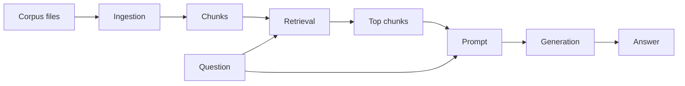

# Experiment: naive RAG baseline

This is the RAG-9 run. Shared functions live in `src/learning_rag`. `config.yaml` records the chunker, ranker, and model id used for this baseline. `run.py` is the command-line entry: it reads that file, runs the four stages, and writes each stage's input and output to `results/last_run.json`.



## Hypothesis

Fixed-size chunks plus term-overlap cosine can surface a passage that shares the query's words. A $0 text model can answer from those passages when the words are actually there.

## Variables

- Corpus: 100 PEP files in `data/raw/peps/`, pinned in `data/raw/SOURCE.txt`
- Questions: 30 rows in `datasets/eval_questions.csv`
- Chunk size, overlap, ranker, and model id: `config.yaml`
- Key and base URL: `MODEL_API_KEY` and `MODEL_BASE_URL` in `.env`
- Token ceilings: `MODEL_MAX_TOKENS` (default 1200) and `MODEL_REASONING_TOKENS` (default 400)

## Run

From the repo root:

```bash
uv run python -m experiments.e01_naive_rag.run
uv run python -m experiments.e01_naive_rag.run "What is a docstring?"
uv run python -m experiments.e01_naive_rag.run --answer --free "What is a docstring?"
uv run python -m experiments.e01_naive_rag.eval
uv run pytest experiments/e01_naive_rag/test_run.py
```

The first command lists chunks. The second ranks them. The third sends the top chunks to the text model. `--answer` reads `.env`.
