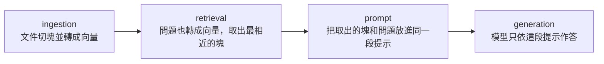

# IR Foundations and a Reproducible Naive RAG Baseline

只做這張票的觀念與最小流程。BM25、hybrid、rerank、Ragas 先認識名字，不實作。

## 1. 用一題走完四格

文件只有兩份：

- `doc-refund`：商品可在出貨後 14 天內退貨。運費不退。
- `doc-shipping`：訂單滿 1000 元免運。離島運費另計。

問題：「買了 10 天，還可以退嗎？」



1. **Ingestion**：兩份文件各成一塊，embed 後放進索引。這一步發生在發問之前，而且要能用同一份 config 重做。
2. **Retrieval**：問題也 embed，用相似度找出最靠近的塊。這一題應先找到 `doc-refund`。
3. **Prompt**：把找到的塊原文貼進提示，並寫明「只根據以下內容回答」。沒貼進去的文件，模型這一次看不見。
4. **Generation**：模型用語音把塊裡的事實說出來，並標來源。它不負責去圖書館，只負責說。

對照題：「運費可以退嗎？」若第一名是 `doc-shipping`（因為「運費」這個詞很像），generator 就會很順地講免運規則，而沒講到「運費不退」。錯在 retrieval，不在最後一句話好不好聽。

用自己的話寫，這四格各自的輸入與輸出是什麼。[答案](#1-四格的輸入與輸出)

## 2. 兩個記憶

模型權重裡已經記住的知識，叫 **parametric memory**。換新規定時，權重不會自己更新，也可能講得很像真的，其實是 hallucination。

另外準備一份可替換的文件索引，叫 **non-parametric memory**。規定改了就重做索引，而且可以指出是哪一段被用到。

RAG 是把兩者接起來：retriever 從非參數記憶拿段落，generator 用參數記憶把段落說成回答。它不是讓模型變聰明，是讓這一次回答看得到外部資料。

必讀：`textbook/papers/lewis-2020-rag.pdf` 的 Abstract 和 Section 1。圖 1 對一下上面的四格。訓練細節、RAG-Sequence / RAG-Token 先跳過。

parametric 與 non-parametric 各舉一個這份專案裡的例子。[答案](#2-兩種記憶的例子)

## 3. 誰負責什麼

| 元件 | 負責 | 不負責 |
|---|---|---|
| Retriever | 找出可能有用的塊，並排序 | 寫出最終回答 |
| Generator | 依提示裡的塊作答 | 把沒被找回的文件補進來 |

找錯了，後面再強也只是把錯的上下文說得很順。

上面那題「運費可以退嗎？」若答錯，你會先查 retriever 還是 generator？為什麼？[答案](#3-先查-retriever-還是-generator)

## 4. 今天先認識、先不實作

- **Inverted index**：關鍵字 → 含有該詞的文件。BM25 用它做稀疏檢索。「14 天」「免運」這種精確詞很強，同義詞很弱。
- **BM25**：給「詞出現次數、詞稀有程度、文件長度」打分的關鍵字檢索。RAG-11 才做。
- **Dense embedding**：把一段文字壓成向量，近義句可以很近，即使沒有共同用詞。Naive baseline 用這個。
- **Cosine / dot product**：兩種向量相似度。長度有被正規化時，排序常常一樣。先記住：我們比的是方向有多接近，不是文字表面像不像。
- **ANN / HNSW**：文件多到不能每題都和全部向量比對時，用近似最近鄰換速度。小 corpus 先精確比對，結果才好檢查。

為什麼 baseline 先不用 BM25，也不用 HNSW？[答案](#4-為什麼先不用-bm25-和-hnsw)

## 5. 兩個檢索指標

相關文件是 `doc-refund`。假設某題的前 5 名是：

`doc-shipping`, `doc-other`, `doc-refund`, ...

- **Recall@5**：對的文件有沒有出現在前 5。有就是 1，沒有就是 0。這題是 1。
- **MRR**：對的文件排名的倒數。排第 3，就是 `1/3`。只看第一個對的文件。
- **端到端延遲**：從送出問題到拿到回答的時間，包含檢索和生成。只量檢索時間不能拿來當這張票的延遲。

Recall@5 是 1、MRR 却只有 0.33，代表找到了，但排太後面。若生成時只看前 1 名，使用者仍會拿到錯的上下文。

手算。前 5 名沒有對的文件時，Recall@5 是多少？MRR 怎麼記？[答案](#5-recall5-與-mrr-手算)

## 6. 檢查點

合上這份筆記再答。答不出來就停，不要進程式。

1. RAG 補的是什麼，不是什麼？[答案](#6-rag-補的是什麼)
2. Retriever 和 generator 各負責什麼？找錯時會發生什麼？[答案](#7-retriever-和-generator)
3. 四格的順序，以及每一格的輸入、輸出？[答案](#8-四格順序與輸入輸出)
4. Recall@5 和 MRR 差在哪？[答案](#9-recall5-和-mrr-的差別)
5. 一筆失敗可能是切塊切壞、同義詞沒對上，或一題要跨兩份文件。各舉一個你自己想的例子。[答案](#10-三種失敗)

## 7. 接下來才做

Corpus 是 `data/raw/peps/` 裡 MANIFEST 釘住的 100 篇 PEP，不要改這些檔。來源在 `data/raw/SOURCE.txt`。機器切法：

```bash
uv run python -m experiments.e01_naive_rag.run
uv run python -m experiments.e01_naive_rag.run "What is a docstring?"
uv run python -m experiments.e01_naive_rag.eval
```

手切這步跳過。人通常按章節切，`fixed_chunks` 每 500 字切一刀，會從句子中間切開。這一章的組裝與執行都在 `experiments/e01_naive_rag/`。

- [ ] 檢查點 1–5 你能口述
- [x] 選定並 pin 住 corpus
- [ ] 手切 1 篇，再對照 fixed chunker
- [ ] 5 個 chunk、2 個 query 的 cosine 排名
- [ ] 有 LLM key 才接 generation
- [ ] 你出題（先 10，目標 30），每題標文件 ID
- [ ] 跑出 Recall@5、MRR、延遲、10 筆失敗
- [ ] README 放上四格資料流

## 答案

### 1. 四格的輸入與輸出

- 多個文件 → Ingestion 切塊並 embed → 輸出索引（塊原文、向量、文件 ID）。這一步在發問之前，不回給使用者。
- 使用者的問題 → Retrieval 把問題 embed，到索引裡找最相近的塊 → 輸出 top-K 個塊，不是整份原始文件。
- top-K 塊原文 + 使用者問題 → Prompt 拼成一段提示（指示 + 塊原文 + 問題，例如「只根據以下內容回答」）→ 輸出這段提示，還不是回答。
- 這段提示 → Generation 用模型權重把提示說成回答，並標來源 → 輸出給使用者的回答。

### 2. 兩種記憶的例子

- parametric 的例子：generation 用的那個模型權重。退貨規定改了，它不會自己更新。
- non-parametric 的例子：`doc-refund` 和 `doc-shipping` 做成的索引（原文 + 向量）。這不是 retriever 模型。Retriever 只是去拿這包索引的工具，它自己的 embedding 權重也是 parametric。
- 問「買了 10 天可以退嗎？」時，被查的那包文件是 non-parametric memory；模型開口說話時用到的權重是 parametric memory。把塊和問題拼在一起只是組 prompt，不是一種記憶。

### 3. 先查 retriever 還是 generator

- 先看 retriever 找回哪幾塊，不要先看回答順不順。
- 「運費可以退嗎？」若第一名是 `doc-shipping`，回答會很順地講免運，句子裡也有「運費」，但文件拿錯。這仍是 retriever 錯。
- Generator 錯長這樣：找回的原文寫「運費不退」，模型卻說「可以退」，或加上原文沒有的規定。
- 關鍵字看起來相關，不夠用來判斷該查哪一格。

### 4. 為什麼先不用 BM25 和 HNSW

- 先不用 BM25，不是因為它比較差。精確詞（「14 天」、API 名稱）它常常更強。Baseline 一次只做 dense，之後加 BM25 才能知道是哪一個改動讓指標變了。這張票也不訓練模型。
- 先不用 HNSW，是因為 corpus 還很小，逐一比對所有向量就夠，而且分數可以檢查。HNSW 是用近似結果換速度，不是另一種語意檢索。

### 5. Recall@5 與 MRR 手算

- Recall@5 是 0。
- MRR 也記 0。這張票只看取出的名單；名單裡沒有對的文件，就沒有排名可倒數。若以後排出全庫名次、對的文件在第 8 名，才是 1/8。

### 6. RAG 補的是什麼

RAG 補的是模型權重裡沒有的文件（non-parametric memory），不是讓模型變聰明，也不是在訓練 retriever。

### 7. Retriever 和 generator

Retriever 負責找出塊並排序。Generator 負責只依提示裡的塊作答。找錯時，generator 仍會把錯的塊說得很順，看起來像有來源，只是來源不對。

### 8. 四格順序與輸入輸出

- Ingestion → Retrieval → Prompt → Generation
- 文件 → Ingestion → 索引（塊、向量、文件 ID）
- 使用者問題 → Retrieval → top-K 個塊，不是整份文件
- 問題 + 塊原文 → Prompt → 拼好的提示，還不是回答
- 提示 → Generation → 回答，並標來源

### 9. Recall@5 和 MRR 的差別

- Recall@5 是在取出來的前 5 個裡有沒有目標文件，有就是 1，沒有就是 0。
- MRR 是沒找到就記 0，找到就是 `1 / 排名`，最高是 1。

### 10. 三種失敗

- 切塊切壞：一份退貨規定前後兩段互相引用，被切成兩塊。只找回第一塊時，看不到它指向的那一段。
- 同義詞沒對上：文件只寫「退貨」，問題寫「可以退款嗎」。字面幾乎沒有共同詞，dense 仍可能沒把 `doc-refund` 排到前面。
- 要跨兩份文件：問「買了 10 天、訂單 800 元，能不能退、運費怎麼算？」`doc-refund` 只夠答能不能退，運費門檻在 `doc-shipping`。只找回一份，回答就不完整。

## 生難字

只服務這一章。本課重點（四格、兩種記憶、chunk、embedding、Recall@5、MRR）不在這裡。

### 筆記和對話裡出現的

- **corpus** / 語料庫：這次固定拿來搜尋的那一整包文件。不是程式，也不是考題。
- **pin** / 釘版：把 corpus 的版本固定住，之後不再改字，比較才算數。
- **config** / 設定檔：寫死切塊大小、模型名稱、seed 的那份檔。換結果時先看它，而不是改程式。
- **seed** / 隨機種子：讓「會抽籤」的步驟每次得到同一結果的起始數字。
- **baseline** / 對照組：第一版可量測的做法。後面的改動要跟它比，不是拿來訓練模型。
- **naive** / 最簡版：故意少做功能的第一版，不是說這個做法很笨。
- **top-K** / 前 K 名：檢索後只留下最相近的 K 個塊。K 是個數字，例如 5。
- **latency** / 延遲：從送出問題到拿到回答要等多久。
- **citation** / 引用出處：回答旁邊標它用了哪一塊，不是論文參考文獻那種 citation。
- **cosine similarity** / 餘弦相似度：兩個向量方向有多接近。用來排名，不是在比句子長得像不像。
- **dot product** / 內積：另一種向量相似度。向量長度先被拉齊時，排名常跟 cosine 一樣。
- **normalize** / 正規化：把向量長度調成一樣，避免長文只因為比較長就得分高。
- **sparse** / 稀疏：大多位置是空的。關鍵字檢索是稀疏的，因為一篇文件只含少數詞。
- **inverted index** / 倒排索引：詞 → 含有這個詞的文件。不是把文件倒著排。
- **BM25**：給關鍵字檢索打分的公式，會看詞出現次數、詞稀不稀有、文件長不長。
- **ANN** / 近似最近鄰：不全數比對，用差不多最近的結果換速度。
- **HNSW**：一種 ANN 索引結構。它不是一種 embedding。
- **hybrid** / 混合檢索：關鍵字檢索和向量檢索一起用。
- **rerank** / 重排序：先粗抓一批，再用另一個模型把這批重新排過。
- **Ragas**：一套現成的 RAG 評分工具。今天的 Recall@5、MRR 不是用它算的。

### 論文 Abstract、Section 1、Figure 1 裡出現的

- **pre-trained** / 預訓練：拿來用之前，已經在大量文字上訓練過。不是我們這張票要做的事。
- **fine-tune** / 微調：在已訓練好的模型上，再用任務資料接著訓練。這一章不微調。
- **downstream task** / 下游任務：模型訓練完之後拿去解的具體任務，例如問答。
- **knowledge-intensive** / 知識密集：不查資料就幾乎答不出來的任務。
- **state-of-the-art (SOTA)** / 當時最好：論文發表時，公開成績裡最高的那一檔。
- **hallucination** / 幻覺：講得像真的，但沒有依據。權重裡沒有那條規定時，模型仍可能編一條。
- **provenance** / 出處：這個答案是從哪一段來的。論文說一般模型很難提供這個。
- **weights / parameters** / 權重：模型裡那一大組數字。parametric 的「參數」就是指這包數字，不是函式的引數。
- **seq2seq** / 序列到序列：輸入一段文字、輸出一段文字的模型形式。論文裡的 generator 是這種。
- **token** / 詞元：模型實際讀寫的小單位，通常比「一個字」更碎，也不等於一個單字。
- **passage** / 段落：從長文切出來、拿去檢索的一小段。我們筆記裡叫塊。
- **query** / 查詢：拿去搜尋的那句話。在這一章裡就是使用者的問題。
- **MIPS** / 最大內積搜尋：在一大堆向量裡，找內積最大的那幾個。Figure 1 的檢索就是在做這個。
- **latent variable** / 隱變數：生成時會用到、但使用者沒直接給的東西。論文把找回的文件當成隱變數。
- **marginalize** / 邊際化：把多個可能文件各自的預測併成一個最終預測。Figure 1 的字，今天不用算。
- **end-to-end** / 端到端：從輸入直接訓到輸出，中間不再人工拆開訓練。也用來指「從發問到答完」的整段時間。
- **backprop** / 反向傳播：訓練時把誤差傳回模型、用來改權重的算法。圖上的箭頭，不是查詢流程。
- **differentiable** / 可微分：這個步驟能參與 backprop。看不懂不影響今天的四格。
- **extractive** / 抽取式：答案必須是原文裡抄出來的一段，不能自己組句。RAG 論文想做的是生成，不是只抽取。
- **open-domain QA** / 開放域問答：問題沒有先附上那一頁文章，系統得自己去整庫裡找。
- **fact verification** / 事實查核：判斷一句話是否被資料支持，不是在寫一段回答。
- **condition on** / 以某物為條件：生成時要看著某段文字來寫。`conditions on the retrieved passages` 就是「看著找回的段落來生成」。
- **DPR** / Dense Passage Retriever：論文用來找段落的那個預訓練 retriever 的名字。
- **BART**：論文用來生成的那個預訓練 seq2seq 模型的名字。
- **transformer**：一種模型結構。BART 是它的一種。看到這個詞，不必停下來學結構。
